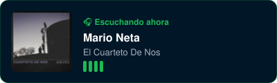

## 💫 Sobre mí

- 💻 Desarrollador web, me gusta construir cosas de punta a punta
- 🌱 Profundizando en **React**, **TypeScript** y **cloud**
- 🎧 Programo con música — mira abajo qué estoy escuchando

## 🛠️ Tech Stack

   
   
   
  

## 📊 GitHub Stats

  
  
   
  

## 🎧 Escuchando ahora

  

 

  

